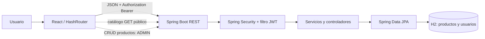

# Documento de integración — Culto Chamán TCG Store

## Arquitectura

El navegador ejecuta React y se comunica por HTTP/JSON con Spring Boot. En local la API es `http://localhost:8081/api`; en la EC2 configurada es `http://100.52.124.23:8081/api`. Spring MVC valida solicitudes, Spring Security verifica JWT y roles, Spring Data JPA persiste entidades en H2 (desarrollo) o MySQL (producción, perfil `prod`). La firma JWT usa una clave HMAC configurada por entorno. El navegador no puede asignar el rol durante el registro: el servidor crea todas las cuentas nuevas como `USER`.

## Modelo de datos

| Entidad | Campos | Regla |
| --- | --- | --- |
| `Product` | `id`, `nombre`, `tipo`, `atributo`, `descripcion`, `precio`, `imagen`, `stock` | PK textual; nombre/tipo/atributo/descripción/imagen obligatorios; precio no negativo. |
| `Order` / `OrderItem` | `id`, `user`, `status`, `subtotal`, `discount`, `total`, `coupon`, `createdAt`; líneas con `productId`, `productName`, `unitPrice`, `quantity` | Las líneas guardan copia del nombre y precio al comprar. Estados: PENDING, PAID, SHIPPED, CANCELLED. |
| `UserAccount` | `id`, `fullName`, `email`, `passwordHash`, `phone`, `region`, `commune`, `role`, `createdAt` | Email único en minúsculas; contraseña almacenada como BCrypt; rol `USER` o `ADMIN`. |

El catálogo de ocho cartas se inicializa solo cuando la tabla está vacía. Un administrador semilla se crea solo si el correo configurado no existe. JPA administra la conexión y el esquema H2 con `ddl-auto=update` en este entorno de evaluación.

## Endpoints REST

| Método | Ruta | Autorización | Resultado |
| --- | --- | --- | --- |
| `POST` | `/api/auth/register` | Pública | Crea cuenta `USER` y devuelve perfil sin hash ni token. |
| `POST` | `/api/auth/login` | Pública | Valida BCrypt y entrega token JWT, email, nombre y rol. |
| `GET` | `/api/auth/me` | Usuario autenticado | Devuelve perfil actual; el frontend lo usa para restaurar sesión. |
| `GET` | `/api/products` | Pública | Lee catálogo completo. |
| `GET` | `/api/products/{id}` | Pública | Lee carta; 404 si no existe. |
| `POST` | `/api/admin/products` | `ADMIN` | Crea una carta; 409 si el id existe. |
| `PUT` | `/api/admin/products/{id}` | `ADMIN` | Actualiza carta existente. |
| `DELETE` | `/api/admin/products/{id}` | `ADMIN` | Elimina carta existente; respuesta 204. |
| `POST` | `/api/auth/refresh` | Pública (con refreshToken) | Renueva token de acceso y de refresco; rechaza access tokens y tokens vencidos. |
| `POST` | `/api/orders` | Usuario autenticado | Crea pedido: precio calculado en servidor, valida stock, aplica cupón `POKEMON10`, descuenta inventario. |
| `GET` | `/api/orders` | Usuario autenticado | Lista los pedidos propios. |
| `GET` | `/api/orders/{id}` | Dueño o `ADMIN` | Detalle de pedido (404 si es de otro usuario). |
| `POST` | `/api/orders/{id}/cancel` | Dueño o `ADMIN` | Cancela y devuelve el stock. |
| `GET` | `/api/admin/orders` | `ADMIN` | Lista todos los pedidos. |
| `PUT` | `/api/admin/orders/{id}/status` | `ADMIN` | Cambia estado (PENDING→PAID→SHIPPED, o CANCELLED). |
| `GET` | `/api/admin/users` | `ADMIN` | Lista perfiles sin hashes. |
| `GET` | `/api/admin/users/{id}` | `ADMIN` | Lee un perfil. |
| `PUT` | `/api/admin/users/{id}/role` | `ADMIN` | Cambia rol USER/ADMIN (no el propio). |
| `DELETE` | `/api/admin/users/{id}` | `ADMIN` | Elimina cuenta existente. |

La especificación interactiva y los esquemas de solicitud están en Swagger UI (`/swagger-ui.html`) y `/v3/api-docs`. Para operaciones protegidas, iniciar sesión en Swagger y usar `Authorize` con el token recibido (sin anteponer `Bearer ` si Swagger aplica el esquema HTTP Bearer).

## Flujo de comunicación

1. Al abrir el catálogo, React solicita `GET /api/products` y presenta los productos persistidos.
2. Registro envía nombre, correo, contraseña y datos de contacto como JSON. Backend valida, normaliza correo, aplica BCrypt y guarda la cuenta; el rol nunca llega desde el navegador.
3. Login envía correo y contraseña. Backend compara el hash y emite un access token (1 h) y un refresh token (7 días) firmados, con sujeto=email, rol y tipo. Un refresh token no sirve como access token y viceversa.
4. React guarda token y perfil en `sessionStorage`. Tras recargar, consulta `/api/auth/me`; si falla o venció, limpia la sesión.
5. El frontend oculta el panel de administración a usuarios sin rol `ADMIN`. Además, Security verifica el rol en el servidor para cada CRUD; ocultar una ruta en React por sí solo no sería control de acceso.
6. Los cambios CRUD responden JSON/204. El panel vuelve a consultar el catálogo tras cada mutación para reflejar el estado persistido.

CORS permite el origen local del frontend (configurable con `FRONTEND_ORIGIN`) y los métodos HTTP utilizados. Las rutas sin sesión no reciben token. La política es stateless: el backend no mantiene una sesión HTTP.

## Pruebas de integración

`backend/src/test/java/cl/cultochaman/api/ApiIntegrationTest.java` levanta Spring Boot y H2 en memoria con MockMvc. Comprueba lectura pública, registro y asignación `USER`, login y `/auth/me`, rechazo de CRUD para el rol USER, y creación/actualización/eliminación de producto para ADMIN, incluyendo 404 tras eliminar. Se ejecuta con `cd backend && mvn test`. Está implementada, pero no fue ejecutada en el entorno de trabajo porque Maven no está instalado.

## Decisiones y límites de la demostración

- H2 local permite ejecutar sin instalar un servidor de base de datos externo. Para un despliegue real se debe usar un motor administrado, migraciones versionadas, secretos fuera del repositorio, HTTPS y desactivar consola H2.
- JWT en `sessionStorage` sobrevive recargas de la pestaña, pero no es inmune a XSS; producción debería evaluar cookies `HttpOnly`, `Secure`, `SameSite`, protección CSRF según el flujo y una política estricta de contenido.
- La cuenta ADMIN semilla usa valores de desarrollo por defecto y debe cambiarse por variables de entorno antes de compartir/desplegar.
- El backend ya registra pedidos y controla stock (`/api/orders`); no procesa pagos. El cliente solo envía ids y cantidades, nunca precios.
- Despliegue en AWS EC2 (Nginx + Spring Boot + MySQL/RDS): ver `docs/DESPLIEGUE_EC2.md`.
- La lista pública de productos es legible sin login; el CRUD de escritura y la gestión de usuarios requieren ADMIN.
